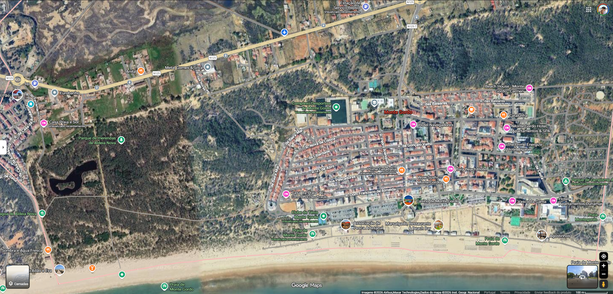

# Battle for Monte Gordo

Um jogo de rua para jogar por equipas, cada equipa com o telemóvel, em Monte Gordo (Algarve).
As equipas correm para **territórios** reais (Casino, praias, Pinhal, Sushi, Ténis, Campismo, Prime…), cumprem
um desafio no local, enviam uma **prova em foto ou vídeo** e conquistam o território. Ganha a equipa com mais pontos.

▶ **Experimentar:** https://diogoguedes0305.github.io/jogo-monte-gordo/

## Como se joga

1. **Lobby → Novo Jogo**: cria as equipas (nome, cor e foto) e escolhe em cada telemóvel qual é a sua equipa. Depois carrega em **▶ Jogar**.
2. **Sala de espera**: cada equipa carrega em "Estou pronto". O jogo começa quando estão todas prontas.
3. **No jogo**: vai a um território, abre-o no mapa, cumpre o desafio e envia a prova. O território passa a ser teu
   e vale pontos até alguém to roubar.
4. Cada conquista dá **cartas**, e pode-se ter até 3 na mão:
   - **Vantagens**: Escudo 🛡️, Carta Extra 🎟️, Espião 🕵️, Corrida 👟, Limpeza 🧽, Bónus 💰
   - **Ataques**: Assalto ⚔️, Roubo de Carta 🥷, Congelar ❄️, Castigo Físico 🏃, Maldição da Direita ↪️, Lentidão 🐌
5. **Desafios Relâmpago** ⚡: aparecem de surpresa e a primeira equipa a enviar a prova ganha.
6. **Fim do jogo**: uma equipa propõe terminar e aparecem o pódio, os pontos bónus secretos e os confetes.

Em **Gestão** podes mudar o nome do jogo, o mapa, os territórios (pontos, ícone e posição), os desafios,
as cartas do baralho e os Desafios Relâmpago. Também podes guardar **áreas** para jogar noutra terra.

## A versão de demonstração

O link de cima abre a versão de demonstração, em `jogo/`:
- Cada grupo joga numa **sala** só sua: o link ganha `?sala=XXXXX`, e é esse o link que se manda às outras equipas.
- Uma sala nova começa com os territórios e desafios de Monte Gordo.
- Não tem notificações push.

## Tecnologia

- **Um único ficheiro** (`firebase/public/index.html`): HTML, CSS e JavaScript, sem build nem dependências.
- **Firebase Realtime Database** para o estado do jogo em tempo real, e **Firebase Hosting** para o alojamento.
- **Cloudinary** para as fotos e vídeos de prova (upload direto do browser, com preset unsigned).
- **Notificações push** por Firebase Cloud Messaging, enviadas por um **Cloudflare Worker** (`cloudflare-worker/`).
  A credencial é um secret do Worker e nunca entra no código.
- `apps-script/` é a primeira versão do jogo, feita em Google Sheets e Apps Script. Fica para referência.
- `card-mockups/` e `regras-mockups/` são os protótipos das cartas e das regras.

### Alojar o teu próprio jogo

1. Cria um projeto no Firebase com Realtime Database e Hosting.
2. Em `firebase/public/index.html`, troca `firebaseConfig` pela configuração do teu projeto, e
   `CLOUDINARY_CLOUD_NAME`/`CLOUDINARY_UPLOAD_PRESET` pelos da tua conta Cloudinary.
3. Importa `firebase/seed.json` para a base de dados (são os territórios iniciais).
4. Dentro de `firebase/`, corre `firebase deploy`.
5. As notificações push são opcionais: gera a chave VAPID (`FCM_VAPID_KEY`), publica o Worker com `npx wrangler deploy`
   e define o secret `FIREBASE_SERVICE_ACCOUNT_JSON`.

> ⚠️ O `database.rules.json` deixa a base de dados aberta para leitura e escrita, para ser simples entre amigos.
> Para um evento público, junta autenticação e regras mais apertadas.

---
Feito por Diogo Guedes, com a ajuda do Claude.
