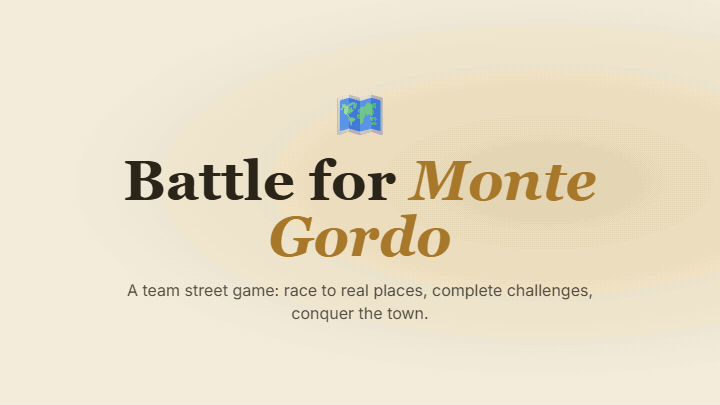
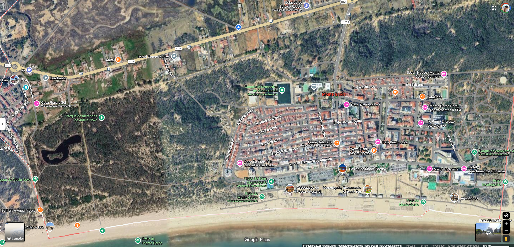

  
  &nbsp;
  

# Battle for Monte Gordo

A street game for teams, each team with a phone, in Monte Gordo (Algarve, Portugal).
Teams race to real **territories** (the Casino, beaches, the pine forest, restaurants, tennis courts, the campsite…),
complete a challenge on site, send a **photo or video as proof** and conquer the territory. The team with the most points wins.

▶ **Try it:** https://diogoguedes0305.github.io/jogo-monte-gordo/

🎬 Animated demo · from creating teams to the winner

> The game itself is in Portuguese.

## How to play

1. **Lobby → Novo Jogo**: create the teams (name, colour and photo) and choose on each phone which team it plays for. Then tap **▶ Jogar**.
2. **Waiting room**: each team taps "Estou pronto" (I'm ready). The game starts when every team is ready.
3. **In the game**: go to a territory, open it on the map, complete the challenge and send the proof. The territory
   becomes yours and is worth points until someone steals it.
4. Every conquest gives you **cards**, up to 3 in your hand:
   - **Advantages**: Shield 🛡️, Extra Card 🎟️, Spy 🕵️, Race 👟, Clean-up 🧽, Bonus 💰
   - **Attacks**: Assault ⚔️, Card Theft 🥷, Freeze ❄️, Physical Punishment 🏃, Right-Turn Curse ↪️, Slowness 🐌
5. **Lightning Challenges** ⚡: they pop up by surprise and the first team to send the proof wins.
6. **End of the game**: one team proposes to finish, and the podium, the secret bonus points and the confetti appear.

In **Gestão** (management) you can change the game name, the map, the territories (points, icon and position), the challenges,
the cards in the deck and the Lightning Challenges. You can also save **areas** to play in another town.

## The demo version

The link above opens the demo version, in `jogo/`:
- Each group plays in its own **room**: the link gets `?sala=XXXXX`, and that's the link you send to the other teams.
- A new room starts with the Monte Gordo territories and challenges.
- It has no push notifications.

## Technology

- **A single file** (`firebase/public/index.html`): HTML, CSS and JavaScript, no build step and no dependencies.
- **Firebase Realtime Database** for the live game state, and **Firebase Hosting** for hosting.
- **Cloudinary** for the proof photos and videos (direct upload from the browser, with an unsigned preset).
- **Push notifications** with Firebase Cloud Messaging, sent by a **Cloudflare Worker** (`cloudflare-worker/`).
  The credential is a Worker secret and never goes into the code.
- `apps-script/` is the first version of the game, built with Google Sheets and Apps Script. Kept for reference.
- `card-mockups/` and `regras-mockups/` are the prototypes for the cards and the rules.

### Host your own game

1. Create a Firebase project with Realtime Database and Hosting.
2. In `firebase/public/index.html`, replace `firebaseConfig` with your project's config, and
   `CLOUDINARY_CLOUD_NAME`/`CLOUDINARY_UPLOAD_PRESET` with your Cloudinary account's.
3. Import `firebase/seed.json` into the database (the initial territories).
4. Inside `firebase/`, run `firebase deploy`.
5. Push notifications are optional: generate the VAPID key (`FCM_VAPID_KEY`), publish the Worker with `npx wrangler deploy`
   and set the `FIREBASE_SERVICE_ACCOUNT_JSON` secret.

> ⚠️ `database.rules.json` leaves the database open for reading and writing, to keep things simple among friends.
> For a public event, add authentication and tighter rules.

---
Made by Diogo Guedes, with the help of Claude.
